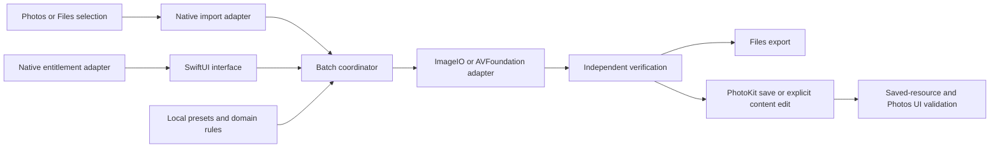

# Zlarp Metadata Editor — iPhone-first planning revision

Review date: October 7, 2026. Status: research and planning only; feasibility has not been demonstrated on a device. No application code, dependencies, signing assets or device settings were changed.

This revision supersedes the delivery, architecture and milestone decisions in [the original development specification](C:/Users/vxti2/.codex/.chatgpt-projects/g-p-6ac6dfe15d608191a16c596446f38c4a/Zlarp-Metadata-Editor-Development-Plan.md). The original document remains unchanged as the detailed research record. Its requirements and technical findings remain applicable where the review below says so. This revision was written after reviewing that specification and completing native Photos, engine/architecture and distribution research.

## 1. Corrected requirements and recommendation

The owner's clarification changes the product materially: a computer may be used for installation, but customers must not need one for ordinary processing. The owner's existing IPA distribution is reported project information; it makes native delivery a legitimate option, but does not yet establish the signing, update or licensing contract for this app.

Evidence convention: **documented/verified** means a public API contract or inspected source, not our runtime test; **reported** means user/owner observations; **proposed** means an engineering choice or acceptance target; **unverified/untested** means integration, performance or physical-device behavior still needs evidence. The architecture and prototype below are proposed. No hardware result was obtained in this task.

**Recommended direction:** an iOS app using SwiftUI, a separately testable Swift media engine, PhotoKit/PhotosUI, ImageIO and AVFoundation. Start with a small native feasibility probe, even if Flutter is later selected for the production interface.

**Central feasibility remains unverified:** Apple provides public asset creation and content-editing APIs, but no documented public control was found for suppressing or clearing Photos' importing-app attribution. Native delivery enables testing these routes; it does not guarantee the requested absence of a “Saved from” label.

Do not authorize a full product build on the assumption that saving a modified file proves the goal. The first gate must establish all three outcomes together: intended camera information in the actual Photos interface, no unwanted source attribution, and preserved media integrity.

### Product requirements

| Requirement | Revised contract |
|---|---|
| Everyday operation | Entirely on iPhone after valid installation; no recurring PC processing/export/upload dependency. |
| Import | User-selected Photos and Files resources; explicitly distinguish current rendered media from original resources. |
| Inspection/editing | Inspect camera/lens/exposure/date/GPS/software/file information and edit only supported fields. |
| Randomization | Custom ranges, linked camera/lens profiles, selected independent fields and reproducible retries. |
| Presets | Create/save/edit/import/export versioned profiles on the device. |
| Batches | Mixed media, frozen settings, per-file overrides, progress, cancellation, retry and individual errors. |
| Removal | Selective supported metadata removal with residual/protected-data disclosure. |
| Export | Original-format file output where qualified; direct PhotoKit save to Photos; Files export available for file-level results. |
| Quality | No unnecessary encoding, format conversion, stream loss or loss of presentation-critical data. |
| Engineering | Clean module boundaries, efficient I/O, meaningful tests, error handling, independent review and license audits. |
| Primary device | User's iPhone 15 Pro Max, reported iOS 27.2; record actual OS version/build and release channel during testing. |
| Excluded | Live Photo conversion, visual/timeline/CapCut-style editing, private Apple APIs and unsupported system modifications. |

JPEG, HEIC, MP4 and MOV are mandatory feasibility formats. PNG remains in the original product requirements; it has not been silently removed, but is outside the smallest initial Photos probe and receives its own subsequent gate. Do not flatten paired Live Photos into still images or discard their video component as an implicit workaround. Identify them and refuse unsupported operations.

File processing is local. Importing an iCloud-only Photos asset or a cloud Files document may require network access to the user's provider. Native licensing and update traffic are separate from media processing; local processing does not promise that every import or launch works offline.

## 2. Review of the original plan: retain, revise, retire

| Original area | Disposition | Reason/impact |
|---|---|---|
| Requirements and evidence labels, §1–2 | Retain technical scope; replace Windows/web-only delivery | Owner's clarified daily workflow supersedes the earlier assumption. |
| Python script critique, §3 | Retain | PNG recompression, destructive renaming/deletion, collisions, warning suppression, fixed timezone/GPS and missing readback remain real risks. |
| React/TypeScript/Vite choice, §4 | Retire as primary architecture | It does not provide native PhotoKit integration by itself. |
| ExifTool capabilities and namespace research, §4/6 | Retain as development oracle/reference | Desktop engine writing support does not establish ImageIO/AVFoundation parity or iOS embedding. |
| Browser ExifTool/WASM, worker and memory findings, §4/9 | Preserve as alternative-platform research | They remain valid warnings for a web variant; there is no need to import that runtime into the preferred native app. |
| Modular UI/domain/engine/I/O/verifier separation, §5 | Retain | Replace browser adapters with native adapters; avoid coupling to a particular UI framework. |
| Format-specific limits, §6 | Retain invariants; requalify every write operation | Native framework capability differs from native desktop ExifTool capability. |
| Dates/GPS/profiles/randomization/removal, §7 | Retain | These domain rules are platform-independent. |
| Payload and presentation verification, §8 | Retain and strengthen after Photos save | Verify both the local output and Photos original/current resources; library display is a separate outcome. |
| Batches, resource budgeting, naming and retry, §9 | Retain principles; replace APIs/thresholds | iOS storage, lifecycle and memory differ; browser worker termination is not an available native cancellation model. |
| Desktop UX/browser support, §10 | Replace | Photos/Files picker and phone-sized inspection/edit/review/results flows become primary. |
| Privacy/security, §11 | Retain principles; adapt enforcement | Native sandbox, permissions, Keychain and parser capabilities replace browser CSP/OPFS concerns. |
| Web Zlarp hosting/gateway, §12 | Retain as historical verified web policy only | Obtain a native distribution/entitlement agreement. Do not assume service-worker rules describe an IPA. |
| Commercial/license risks, §13 | Retain and expand | Signing, distribution, Apple rules, updates and native dependencies add obligations. |
| Windows→iCloud→iPhone validation, §14–15 | Retain as comparator, not customer workflow | It is a useful control for the reported successful result. |
| Automated tests, reviews, Codex workflow, §16/18 | Retain objectives; replace platform tools | Use Swift Testing/XCTest/XCUITest and macOS CI; Flutter adds Dart/widget/channel tests if chosen. |
| Milestones/final specification, §17/19–20 | Supersede | Photos behavior and sustainable signed distribution now precede full feature development. |

Nothing in the original research makes modified camera tags evidence of real camera capture. Preserve that boundary in UI and marketing. The supplied script is a behavioral reference, not a production engine to execute unchanged on iOS.

## 3. Architecture comparison

This is an engineering assessment, not a performance benchmark.

| Architecture | Capability | Cost/risk | Recommendation |
|---|---|---|---|
| Swift/SwiftUI, UIKit where needed | Direct public Apple APIs; native file-backed processing, permissions and lifecycle | Requires macOS/Xcode builds and native engine qualification | Best default for the current iPhone-focused scope. |
| Flutter UI + Swift engine | Can use exactly the same PhotoKit/media engine | Adds Dart/Swift contracts, lifecycle coordination, framework/plugin updates and dual tests | Viable if Android is a committed near-term product or team/UI advantages justify the extra layer. |
| React Native UI + Swift engine | Native modules can expose the same Apple functionality | JS/TS plus native module/codegen/runtime maintenance; previous React choice is not a capability advantage | Consider only for demonstrated staffing/cross-platform benefit. |
| Web UI in a native IPA shell | Native bridge can provide Photos integration | Still needs native engine/permissions; adds a web runtime/security boundary | Technically possible, no clear benefit for this product. |
| Mobile web/PWA | Selected-file processing and sharing can work | No direct public web equivalent of PhotoKit creation/content editing; large-media and lifecycle constraints | Do not select for the exact requested Photos workflow. |

Flutter documents Swift integration and Pigeon-generated typed channels; React Native provides native modules. Their native integration ability is real, but neither changes PhotoKit's attribution rules. Web Share delegates to system-selected share targets and does not establish direct Photos asset control. [Flutter channels](https://docs.flutter.dev/platform-integration/platform-channels), [React Native modules](https://reactnative.dev/docs/turbo-native-modules-introduction), [Web Share specification](https://www.w3.org/TR/web-share/)

If Flutter is selected later, Swift owns Photos/Files access, processing, verification, queue lifecycle and commit operations. Dart receives opaque resource/job IDs, typed settings, summaries and progress through Pigeon. Do not send videos as byte arrays/base64 through the bridge or duplicate metadata validation/randomization rules in both languages. Native expensive work must run off the main thread; an asynchronous channel call alone does not ensure that.

The feasibility probe should use Swift directly so that a UI-framework bridge cannot obscure an Apple API failure. Its processing modules can remain reusable by a future Flutter host. Select a production framework after that gate; no UI framework can fix a failed Photos provenance requirement.

## 4. Three separate metadata layers

1. **Embedded file information:** TIFF/EXIF/XMP camera/lens/date/GPS for images and supported QuickTime/container fields for video.
2. **Photos library information and presentation:** properties/indexed values and what the Photos Info panel actually displays.
3. **Photos provenance:** source/importing-app association and any displayed “Saved from” attribution.

A correct embedded field is necessary for file output but is not sufficient evidence of the native Photos display. Changing `Software`, make/model, filename, or camera keys does not documentably control provenance. Do not use a fabricated app/bundle identity, private re-indexing operation, library database write, or system modification to conceal it.

Apple documents camera information in Photos and media saved from other apps, but no inspected documentation offers a universal attribution-suppression contract. [Photos Info](https://support.apple.com/guide/iphone/see-photo-and-video-information-iph0edb9c18f/ios), [Recently Saved](https://support.apple.com/guide/iphone/find-recently-saved-photos-and-videos-iph120bd1b3b/ios)

Recent Apple DTS evidence supports this distinction: file-backed JPEG creation preserved resource bytes in the engineer's stated iPad/OS tests, while a data-backed route had an OS-specific metadata/indexing problem. The Photos location/Info layer could disagree with embedded GPS. This is useful evidence for testing file-backed creation, not a guarantee about our device, HEIC/video or attribution. [Apple DTS response](https://developer.apple.com/forums/thread/845667)

**Verdict:** direct native editing/saving is documented; reproducing the exact label-free user experience is technically plausible for certain routes but remains device-unverified. Research neither proves it works nor proves it impossible.

## 5. Public PhotoKit routes and their boundaries

| Route/API | Documented purpose | What it does not establish |
|---|---|---|
| PhotosUI Photos picker / `PHPickerViewController` | User selects media without granting broad library browsing access | Permission to modify arbitrary existing assets; unchanged original representation in every case. |
| `PHAssetResourceManager` file-backed resource access | Retrieve selected asset resources to files | That a requested original is the user's currently edited appearance, or that every resource is locally available. |
| `PHAssetCreationRequest.forAsset()` + `addResource(with:fileURL:options:)` | Create a new asset from image/video resources | Suppression of source attribution; full metadata/display preservation across all formats/OS builds. |
| `PHAssetChangeRequest` file-URL creation factories | Create image/video assets from a file | Different provenance behavior from the resource route; this is a test hypothesis. |
| `PHAssetChangeRequest(for:)` library properties | Change supported library properties, such as date/location/favorite/hidden | Arbitrary embedded make/model/lens modification or original-resource byte replacement. |
| Editing input/output + `contentEditingOutput` | Commit a supported content edit to an existing asset | That camera fields re-index from the edited resource, provenance stays unchanged, or format/orientation constraints permit lossless replacement. |
| `PHAdjustmentData` | Describe edits for an app that can understand/reconstruct them | Permission to pretend an app understands other apps' edit recipes. |
| `PHAsset.sourceType` | Read broad source categories | An app-origin label setter, or proof that “Saved from” is absent. |

Sources: [Photo picker guidance](https://developer.apple.com/documentation/photokit/selecting-photos-and-videos-in-ios), [resource extraction](https://developer.apple.com/documentation/photos/phassetresourcemanager/writedata(for:tofile:options:completionhandler:)), [creation request](https://developer.apple.com/documentation/photos/phassetcreationrequest), [change request](https://developer.apple.com/documentation/photos/phassetchangerequest), [content editing](https://developer.apple.com/documentation/photokit/editing-asset-content), [source categories](https://developer.apple.com/documentation/photos/phassetsourcetype).

Creation options specify filename/type/copy-or-move handling; these are not documented provenance controls. Prefer file-backed creation over decoding media into `UIImage` or copying entire video bytes into memory. Keep the staged output available until the transaction finishes and any requested verification is complete. [Resource creation options](https://developer.apple.com/documentation/photos/phassetresourcecreationoptions)

Current iOS 27 documentation also exposes extended metadata such as caption, keywords and original filename. Do not repeat an outdated claim that PhotoKit categorically cannot handle captions. These additions still do not provide a make/model/lens or importing-app-attribution setter. [Extended metadata](https://developer.apple.com/documentation/photos/phassetextendedmetadata)

### Existing-asset content editing is not raw original-file replacement

Check `canPerform(.content)`, obtain an authorized asset's editing input, produce a `PHContentEditingOutput`, attach real versioned adjustment data, and submit a change request. The app must preserve existing edits or explicitly offer working from the original. It must not overwrite originals inside the Photos library directly.

Return true from `canHandleAdjustmentData` only when the app recognizes the supported schema/version and will actually reconstruct its complete prior adjustments before applying the next change. Recognizing a recipe but applying only the newest change to the returned original/base could discard earlier edits. If an existing recipe is unsupported, use Photos' provided current rendition and report its representation; do not pretend the unedited original is the current user-visible asset. [Adjustment handling](https://developer.apple.com/documentation/photos/phcontenteditinginputrequestoptions/canhandleadjustmentdata)

Inspect resource types rather than selecting the first returned resource: `.photo`/`.video` represent originals; `.fullSizePhoto`/`.fullSizeVideo` represent modified versions; `.adjustmentBasePhoto`/`.adjustmentBaseVideo` are reconstruction bases; `.adjustmentData` contains the recipe. Enumerate actual presence and select deliberately; not every asset has every resource. Current public video-adjustment-base support also cautions against treating older previous-version discussion as a universal limitation. [Resource types](https://developer.apple.com/documentation/photos/phassetresourcetype), [video adjustment base](https://developer.apple.com/documentation/photos/phassetresourcetype/adjustmentbasevideo)

The legacy editing-output contract specifies JPEG for photos and MOV for video, with content displayed upright without depending on orientation metadata. Modern APIs query supported rendered types and request a typed URL; Apple's HDR example uses HEIC. Both facts matter: a forced-JPEG assumption is stale, and arbitrary unchanged-format replacement is not guaranteed. [Legacy rendered contract](https://developer.apple.com/documentation/photos/phcontenteditingoutput/renderedcontenturl), [supported types](https://developer.apple.com/documentation/photos/phcontenteditingoutput/supportedrenderedcontenttypes), [typed URL](https://developer.apple.com/documentation/photos/phcontenteditingoutput/renderedcontenturl(for:)), [HEIC/HDR sample](https://developer.apple.com/documentation/uikit/supporting-hdr-images-in-your-app)

For orientation-dependent media, setting the tag to “up” without rotating the actual data is incorrect. Re-encoding to meet a rendered-output contract would fail the strict compressed-payload preservation gate. Test upright and rotated fixtures separately; inspect which modern rules apply to each output path. If the original type is unavailable, record unsupported instead of converting silently.

Do not promise unlimited editing history or identical rollback semantics for images and video. Inspect original/current/adjustment resources before and after edits and test revert. Preserve independent original fixture copies outside the library before experiments. An old discussion of previous video versions is not proof that every original video is destroyed.

### Permissions and user consent

- Picker-based import exposes selected media; do not request full library access solely to display a picker.
- Saving new assets can use add-only permission, but that permission does not support diagnostic resource readback.
- Existing-asset edits and resource verification require suitable read-write authorization for the asset. Limited access must be handled; a picker identifier is not automatic authorization to mutate that asset.
- The diagnostic probe requests read-write access with a clear explanation. Separately test add-only creation and denied/limited states before choosing the production permission UX.
- Production defaults to separate output/new asset if that route passes the central gate. Editing the visible state of an existing asset must be an explicit user choice, never an implicit duplicate-removal strategy.

## 6. Native import and metadata engine

### Input representation

Photos picker `.current` avoids transcoding where possible, not unconditionally. Prefer file representations/resource extraction for large media. Distinguish “current appearance” from “original file”; show this selection when prior edits exist. Imported representations must be characterized before any integrity claim. [Picker representation modes](https://developer.apple.com/documentation/photosui/phpickerconfiguration-swift.struct/assetrepresentationmode)

Files import uses the document picker/file importer and coordinated, security-scoped access as required by the provider. Copy necessary data into a job-scoped sandbox file, then release provider access. Keep provider files immutable; handle cancellation, deletion, stale access, cloud download and insufficient space. A temporary picker/provider URL is not a permanent app-owned video file.

### Image writing

ImageIO is the first candidate for JPEG/PNG metadata-only edits. Apple's archived QA1895 explicitly describes `CGImageDestinationCopyImageSource` without recompression for JPEG, PNG, PSD and TIFF. That scoped evidence remains useful; it does not certify HEIC or every modern auxiliary-image structure. [Apple QA1895](https://developer.apple.com/library/archive/qa/qa1895/_index.html)

Metadata replacement can overwrite unrelated EXIF/IPTC/XMP unless merging is selected; the merge API documents updates/additions and null-based removal. Build edits from an inspected preservation policy, not a small replacement whitelist that silently loses other data. [Replacement semantics](https://developer.apple.com/documentation/imageio/kcgimagedestinationmetadata), [merge/removal semantics](https://developer.apple.com/documentation/imageio/kcgimagedestinationmergemetadata)

**HEIC is a separate engine gate.** Test original-type ImageIO copy operations and metadata/auxiliary behavior. Apple's HEIF gain-map preservation option and auxiliary APIs are helpful mechanisms, not proof that all item graphs, tiles, depth/portrait data, transformations, HDR and unknown content survive. An ordinary HEIC pass cannot certify those variants. [Gain-map option](https://developer.apple.com/documentation/imageio/kcgimagedestinationpreservegainmap), [image destinations](https://developer.apple.com/documentation/imageio/cgimagedestination)

No fallback to `UIImage` decoding and JPEG/HEIC encoding in a metadata-only operation. If preservation fails, refuse that structure or separately qualify a suitable container implementation. The native engine is not automatically equivalent to desktop ExifTool.

### Video writing

First candidate: same-container `AVAssetExportSession` passthrough with qualified metadata items. Preserve existing non-targeted metadata and inventory every track before export. Passthrough and metadata output are documented; arbitrary ExifTool tags/header edits and full structure retention are not. [Passthrough](https://developer.apple.com/documentation/avfoundation/avassetexportpresetpassthrough), [export metadata](https://developer.apple.com/documentation/avfoundation/avassetexportsession/metadata), [metadata identifiers](https://developer.apple.com/documentation/avfoundation/avmetadataidentifier)

An asset Reader/Writer path accepting compressed samples is a possible fallback, but supported combinations, format hints and non-MOV restrictions must be qualified. It is not an automatic universal replacement for a container-preserving writer. [Compressed writer input](https://developer.apple.com/documentation/avfoundation/avassetwriterinput/init(mediatype:outputsettings:))

Do not convert MP4 to MOV to satisfy a PhotoKit output path without a separately approved scope change. No routine re-encoding, resolution/frame-rate reduction or dropping unknown tracks. Codec/handler descriptors remain read-only derived facts. Qualify make/model/date/location keys per container and actual Photos display; image exposure fields do not automatically exist or display on video.

### Native operation matrix

| Format | Candidate writes | Still unverified |
|---|---|---|
| JPEG | Supported TIFF/EXIF/GPS/lens/exposure/date/XMP edits using ImageIO copy/merge | Exact field coverage, modern gain maps/MPF, Photos re-indexing and attribution. |
| HEIC | Supported ImageIO metadata changes without decoding, if the copy path accepts/preserves the structure | Payload/item/auxiliary/HDR preservation; Photos edited/new-resource behavior. |
| PNG | Copy/merge EXIF/textual metadata where supported | Exact tag coverage and Photos camera-field consumption; no conversion. |
| MP4 | Qualified AVFoundation container metadata in same-container passthrough | Camera display, header dates, timed-data removal, all-track/HDR/timing retention and content-edit eligibility. |
| MOV | Qualified QuickTime metadata in passthrough | Same limitations plus slow-motion/edit lists/timecode/opaque tracks. |

Every operation reports inspect/set/clear/protected/unsupported/untested capability for that exact structure. Block malformed, encrypted or unqualified media before exporting. Do not turn broad framework format support into a field-support claim.

### Dependencies

Prefer Apple frameworks and a small separately justified verifier. Retain desktop ExifTool and FFprobe as development oracles on Windows/cloud macOS; customers do not need them. Launching desktop Perl/subprocess binaries inside an iOS sandbox is not an established engine solution. An embedded interpreter/WASM engine would be a distinct build, security, performance and licensing project.

Exiv2 remains unsuitable as a universal engine: upstream HEIC writing/video limitations and GPL obligations persist. libheif remains a possible diagnostic/parser component only after exact API/build/license review; decoding/encoding does not meet metadata-only preservation automatically. FFmpeg remains a separately justified fallback/oracle, not a mandatory runtime dependency. Preserve the original ExifReader/exifr/piexifjs/zip.js research for web alternatives, not as native dependency requirements. [Exiv2](https://exiv2.org/manpage.html), [libheif](https://github.com/strukturag/libheif), [FFmpeg licensing](https://www.ffmpeg.org/legal.html)

## 7. Preservation, domain behavior and verification

Retain the original engine sequence: inspect → plan → preflight → write staged output → independent metadata/payload/structure verification → Photos/Files commit → post-save verification where authorized.

| Format | Payload checks | Presentation/structure checks |
|---|---|---|
| JPEG | All compressed scans/coding data using a qualified parser | ICC, orientation, dimensions, multi-image/gain-map associations and previews under the selected policy. |
| PNG | IDAT; animation payload only if animation is supported | Palette, alpha, bit depth, CRC, color/HDR and critical chunks. |
| HEIC | Every relevant coded-item/auxiliary extent | Primary item, item references, tiles, codec properties, transforms, color/HDR, depth/gain maps. |
| MP4/MOV | Ordered compressed samples with boundaries per retained track | Complete track inventory, codec configuration, DTS/PTS, durations/edit lists, transform, audio layout, HDR/color and data tracks. |

Unchanged whole-file hashes are expected for an import-only preserved file, but not for metadata changes. Identical `mdat` alone does not detect broken sample offsets. An unchanged codec label or similar preview proves little. Qualify an independent read-only verifier with corrupt-reference/timing/track fixtures; do not trust the writer merely rereading its own output.

Preserve typed date/rational/GPS validation, namespace conflict handling and profile consistency from original §7. Capture wall time, timezone, UTC instant and offset are different values. Reject ambiguous/nonexistent DST values without resolution; never invent UTC from an unknown zone. Do not synchronize modification times with capture times by default. Validate container date ranges.

Profiles synchronize supported make/model/lens/focal/aperture fields and disclose contradictions in serials, MakerNotes, previews or protected tags. Do not synthesize authentic camera MakerNotes. Randomization uses typed ranges/units, optional deterministic seed, linked fields and frozen per-job generated values so retry cannot rerandomize.

Presets use a bounded versioned JSON schema, known keys and explicit migrations, with no commands/scripts/remote references. Location presets are sensitive. Export without private source details by default.

Removal scans duplicate namespaces, supported previews and timed-location data. Preserve color/orientation/HDR/container essentials. Report uninspected/residual information; refuse claims of complete location removal when timed GPS cannot be cleared safely. Library location/date properties must be checked separately from embedded tags, since removal in one layer can leave another intact. Changing an edited rendition does not prove the Photos original resource no longer contains GPS; disclose that residual instead of promising original-level privacy erasure.

C2PA/Content Credentials remain a distinct provenance system; edits can invalidate bindings. Do not claim original credentials remain valid or edited tags prove capture. Live Photo conversion and full credential signing are outside this scope.

## 8. Native modules, batches, resources and UX

| Module | Responsibility |
|---|---|
| UI | Selection, grouped metadata, editing/profile forms, previews, before/after review and results. |
| Domain | Typed fields, timezone/GPS/rational constraints, profile reconciliation, presets/randomization. |
| Import | Photos permissions/resource representation, Files scoped access, local acquisition and identity. |
| Engine | Structure-specific inspect/plan/write; qualified ImageIO/AVFoundation behavior. |
| Verifier | Independent read-only metadata/payload/structure checks and allowed differences. |
| Coordinator | Durable jobs, resource budgets, scheduling/cancellation/retry and frozen settings. |
| Export/Photos commit | Collision-safe Files output, idempotent commit reconciliation, asset identifiers and edit consent. |
| Platform/persistence | Native entitlement contract, secure tokens, settings/preset migrations and recovery. |

Use one repository with clear modules. Prefer Swift actors/structured concurrency for state isolation, but explicitly execute blocking native operations off the UI thread. Do not assume wrapping synchronous work in a task automatically makes it safe for responsiveness.

Begin with one active writer and bounded inspection/preview work. Use sandbox files and incremental hashing; no whole videos in UI state or Flutter/JS messages. Budget source staging, output, Photos import staging and temporary verification files. Handle disk-full and library-save failure without losing the verified Files output.

Queue states distinguish acquired, inspected, planned, writing, verified, saving-to-Photos, saved, exported, failed, unsupported and cancelled. Record commit identifiers. Cancellation cannot roll back an already committed PhotoKit change; prevent new commits, finish reconciliation and report what was saved. On app termination, an interrupted save may have succeeded: reconcile recorded identifiers or mark the result uncertain rather than auto-retrying and creating duplicates. Do not delete unrelated assets to repair uncertainty.

A synchronous in-process ImageIO operation is not a killable browser worker. Acknowledge cancel promptly, cooperatively cancel I/O/AVFoundation where supported, discard later native results when cancelled, and block commit. Do not carry over the original “terminate worker in two seconds” guarantee.

Use job-scoped temporary storage, cleanup on completion/cancellation and orphan recovery at launch. Protect sensitive files, exclude temporary media from unintended backup where appropriate, and explain retention. Do not promise secure erasure from flash or Photos/iCloud originals.

**Background work:** current Apple APIs provide `BGContinuedProcessingTask` for user-started long-running operations with progress/cancel UI. Submission can be queued/rejected and tasks can expire/terminate. Qualify it on the target OS/device; retain foreground/pause/restart behavior. No promise that a large batch survives force-quit, resource pressure or lock indefinitely. [Continued processing](https://developer.apple.com/documentation/backgroundtasks/performing-long-running-tasks-on-ios-and-ipados), [task contract](https://developer.apple.com/documentation/backgroundtasks/bgcontinuedprocessingtask)

Do not reuse desktop resource limits as iPhone guarantees. Proposed measurement tiers: representative 5–100 MB stills; short clips, 100 MB and 1/4 GB videos; batches of 25/100/500 stills plus mixed videos. Publish only tiers that pass actual storage, memory, thermal, foreground/background and cancellation tests. Start with small copy/hash buffers and tune from profiling; record process memory, not just app model allocations.

Phone flow: choose Photos/Files → inspect → edit/profile/randomize/remove → review changes/capabilities → process → save verified files to Photos or Files → results. Bulk screens show mixed values and unsupported counts. Photos save confirmation, field verification and source-attribution qualification are separate statuses. Support VoiceOver, Dynamic Type, readable errors and keyboard/navigation accessibility where applicable.

## 9. Security and privacy adaptation

The original security requirements survive the platform switch: hostile metadata/presets/filenames, bounded parsing/decompression, text-safe rendering, no executable engine flags, no remote metadata references, pinned/audited dependencies, redacted logs and independent review.

Use native sandbox files, minimum Photos permissions and Keychain for appropriate tokens. Keep source media, filenames, GPS, thumbnails, tag values and presets out of licensing APIs/crash telemetry. Native entitlement verification does not justify uploading media. Any optional geocoding/map service must disclose location transmission.

In-process native parsers can crash the app, and cancellation cannot cure every parser bug. Require malformed-file tests, bounds validation before calling lower-level parsers, fuzzing where practical, tested framework/component versions and prompt maintenance. Code signing does not establish parser safety.

Keep CI certificates/profiles/API keys in protected secrets/temporary build keychains; never commit them or embed privileged signing/marketplace secrets in the IPA. Use permitted team roles rather than sharing Apple passwords. Document actual network flows, including user-requested iCloud downloads and licensing traffic.

## 10. Minimal feasibility prototype — specification only

**Do not build it during this planning task.** Its later approval should be limited to the probe, not interpreted as approval for the full application.

### Stage A: isolate Photos behavior from engine behavior

Build a small signed Swift/SwiftUI diagnostic app with file selection, existing-asset selection, a fixed route selector, a save/edit action and a local results log. No commercial UI, randomization library, account system, billing or broad metadata engine is necessary.

Use prepared original/edited fixture pairs with distinct, recognizable camera values and dates/locations. Validate compressed data and structure independently before device tests. Preparation on Windows/cloud macOS is test setup, not a customer PC dependency. Do not execute the destructive reference script unchanged.

Start with ordinary JPEG, native iPhone HEIC, AVC MP4 and HEVC MOV. Add an orientation-dependent still/video and HEIC/HDR fixture where available because ordinary upright samples alone can hide the editing-output conflict.

| Route | Minimum test | Hypothesis being tested |
|---|---|---|
| A — file-backed resource creation | New `.photo`/`.video` asset with `PHAssetCreationRequest.addResource` | Embedded values and payload survive; camera UI matches; attribution absent or present. |
| B — convenience file creation | New asset using image/video file-URL factory | Whether this documented alternate route behaves differently. |
| C — existing content edit | Eligible existing Camera/iCloud-origin asset; requested supported type, genuine adjustment recipe | Whether existing association remains and Photos displays edited camera values without compromising quality. |
| D — library-properties control | Existing asset date/location change only | Demonstrates library-property changes separately; cannot substitute for make/model edits. |
| E — no-op control | Where contract permits, unchanged resource/import and unchanged-content edit | Separates saving/editing effects from engine changes. |

A–C across four formats are the core comparison. D/E can use representative assets; expand only to explain results. Optionally reproduce a JPEG data-backed save as a diagnostic control, since it has documented OS-specific issues; do not adopt it as the default.

Use fresh disposable Camera-origin assets and disposable previously successful iCloud-uploaded controls. Include an already app-attributed source to distinguish preserving label absence from removing a pre-existing label. **Do not create every existing-asset control through the probe itself:** that could contaminate the very source association being tested. If using duplicates, first verify their displayed origin; an app-created duplicate is a new-asset route, not equivalent evidence of editing a Camera-origin asset.

Independently archive original fixture resources. Existing-asset test changes must be explicitly selected/consented to on disposable controls. Log `canPerform`, input representation, adjustment handling, supported output types and orientation. Unsupported types or a required re-encode are explicit failures for strict preservation, not invitations to silently convert.

### Stage B: prove on-device metadata processing

Only after Stage A identifies a potentially qualifying route, add the smallest native transformation for fixed supported camera/date/location fields. Import from both Photos and Files, modify on the iPhone, verify the staged file, and repeat A/C where applicable for all four formats. Add selective GPS removal. Do not count pre-edited fixture saves as proof that the engine works entirely on iPhone.

If HEIC/video adapters cannot preserve required data or write the intended fields, record unsupported/failure and stop expansion. Do not compensate with image/video conversion. PNG and broad randomization/presets remain later milestone work.

### Evidence required per case

- Device model, actual iOS version/build/channel, app bundle ID/name/build/signing channel and library/iCloud settings.
- Fixture identity, source origin, original/current resource inventory and baseline Photos Info screenshots.
- API route, permissions, chosen representation/type, orientation, change completion/errors and asset identifier before/after.
- Requested fields, staged embedded readback, independently extracted Photos original/current resource readback, library dates/location and actual displayed camera/lens/exposure information.
- Exact source-attribution text or screenshot-evidenced absence. `sourceType` alone is not evidence of absence.
- Payload/sample hashes, tracks, timing, codec configuration, transforms, ICC/color/HDR and auxiliary structures; no-op file imports should additionally compare whole bytes.
- Observations immediately, after Photos relaunch and after iCloud sync settles; repeated trials. A temporary missing label while indexing is not a reliable pass.
- Revert behavior/resource retention for existing edits, and Files export of processed media without a PC.

Use read-write access in the probe for resource verification; separately characterize add-only production saving. Record at least three independent repeats for a candidate successful route, both import sources, and relevant original origins. Record dates/timezones and location in both file and library layers.

### Go/no-go outcomes

| Outcome | Meaning | Next action |
|---|---|---|
| Full candidate pass | On-device processing, intended Photos camera display, absent unwanted attribution and integrity pass for required formats/routes | Proceed to engine hardening; scope all claims to tested device/build/structures. |
| Existing-asset-only pass | C works for eligible assets, but new Photos creation from Files fails the attribution/display gate | Does not satisfy the full requirement; obtain an explicit product-scope decision. |
| Format-specific pass | Some formats/structures pass, others fail | Report exact gaps; no all-format promise or automatic exclusion. |
| Failure | No public route meets display, attribution and preservation together | Stop full development; discuss altered requirements or a restricted product. |
| Inconclusive | Embedded changes pass, but hardware UI/attribution/save resources were not verified | More evidence needed; no feasibility claim. |

If an existing edit preserves a label-free source but the Info panel keeps the original camera values, that route fails the central requirement. If a new asset preserves perfect file bytes but displays an unwanted app label, that route also fails it. A Files-only success does not fulfill direct Photos saving.

### Hardware versus simulator

Simulator/cloud tests can exercise parsing, field validation, queue/error/permission flows and parts of PhotoKit integration. Real iPhone testing is required for Photos Info/source attribution, iCloud sync, genuine HEIC/HDR/auxiliary/video playback, representation transformations, resource/memory/thermal behavior and customer signing/install/update operation. A remote simulator screenshot cannot establish the user's device outcome.

Keep the reported Windows→iCloud→iPhone success as a control, including its exact fixture/type. Do not require that route for daily use or extrapolate an image success to videos.

## 11. Windows development, cloud macOS and distribution

Windows can host source editing, planning and CI dispatch; iOS compilation, simulator tests, archives and signing require macOS/Xcode. Flutter has the same requirement. Access to a cloud Mac solves development-tool availability, not device testing or distribution. [Apple Xcode requirements](https://developer.apple.com/xcode/system-requirements), [Flutter iOS release workflow](https://docs.flutter.dev/deployment/ios)

Candidate CI providers: GitHub Actions macOS/Apple-silicon runners or Codemagic native-iOS/Flutter builds. Verify the required Xcode SDK/image/build exists and succeeds with this project before choosing a provider. Xcode Cloud is another option but standard initial onboarding needs Xcode access. Keep builds reproducible and provider configuration thin; retain commit/version, tests, archive/IPA/dSYMs, component/signing manifest and checksums. [GitHub runners](https://docs.github.com/en/actions/reference/runners/github-hosted-runners), [GitHub signing](https://docs.github.com/en/actions/how-tos/deploy/deploy-to-third-party-platforms/sign-xcode-applications), [Codemagic signing](https://docs.codemagic.io/yaml-code-signing/signing-ios/), [Xcode Cloud onboarding](https://developer.apple.com/documentation/xcode/configuring-your-first-xcode-cloud-workflow/)

The current Xcode requirements list includes an iOS 27.2 beta SDK. That makes the user's reported device version plausible as a testing baseline; record the actual version/build/channel and match the toolchain rather than repeating the prior public-release snapshot as a device verdict. Provider images are time-sensitive and must be verified again when building.

| Distribution channel | Constraint | Planning use |
|---|---|---|
| Free Personal Team | Provisioning expires after seven days; rebuild/reinstall required | Temporary development only; cannot support a once-only permanent install claim. |
| TestFlight | Each build lasts up to 90 days; replacement builds/review requirements apply | Prefer for an authorized prototype/beta if owner/account permits; not permanent customer delivery. |
| Ad hoc | Registered devices/profile; 100 iPhones per team/membership year; expiry/renewal apply | Small test/pilot cohort, not assumed scalable public sales. |
| Enterprise | Qualifying internal employee applications | Not a public paid-consumer channel. |
| App Store/unlisted App Store | Review and payment/storefront rules; unlisted still needs review | Maintained consumer distribution candidate, subject to owner commercial fit. |
| Apple-authorized alternative distribution | Regional eligibility, notarization and channel requirements | Must establish actual customer eligibility and owner authorization; a website hosting an IPA is insufficient. |

Sources: [Personal Team](https://developer.apple.com/help/account/basics/about-your-developer-account), [TestFlight](https://developer.apple.com/help/app-store-connect/test-a-beta-version/testflight-overview/), [device limits](https://developer.apple.com/help/account/devices/devices-overview), [ad hoc profiles](https://developer.apple.com/help/account/provisioning-profiles/create-an-ad-hoc-provisioning-profile), [Enterprise](https://developer.apple.com/programs/enterprise/), [unlisted apps](https://developer.apple.com/support/unlisted-app-distribution/), [alternative distribution](https://support.apple.com/en-us/118110).

Inspect the actual profile `ExpirationDate`, certificate, bundle/team identity, allowed devices and entitlements. An unsigned IPA is a build artifact, not an installable release. A signed IPA is not by itself evidence of an authorized sustainable installation channel. Do not assume US customers qualify for regional alternative distribution.

Separate **no PC for everyday processing** from **no future PC for signing renewal or updates**. The latter remains a distribution decision. Ask the owner how the existing IPA is signed, installed, renewed, updated and recovered after revocation. Do not recommend private/system modification or unapproved enterprise signing as a production solution.

## 12. Zlarp native integration and commercial questions

Public Zlarp documentation previously established a web-build/gateway offering and monthly/60% terms. It does not refute the owner's new information about an IPA product; equally, it does not document that native product's integration contract. Preserve those web findings as context and confirm the native agreement separately. [Public developer page](https://zlarp.com/developers), [public agreement](https://zlarp.com/developer-agreement)

Proposed native boundary: Zlarp's server owns verified purchases/bundles; an owner-documented activation/session API supplies permitted entitlement state; the app stores appropriate credentials securely and performs local media work. Offline grace, expiry/refund/revocation and ongoing-job behavior need explicit terms. A permitted signed lease may be suitable, but no token schema/endpoint/offline policy was verified; do not invent one. Client code cannot provide perfect DRM.

App Store digital-feature/payment rules and storefront exceptions need a review against the chosen distribution and Zlarp purchase flow. This app is not automatically a reader app or approved externally purchased companion. Do not assume sideloading or a purchase website removes all contractual obligations. [Apple review guidelines](https://developer.apple.com/app-store/review/guidelines/)

Obtain owner answers before production commitment:

1. Which existing IPA/app and installation instructions demonstrate the intended channel? Who owns its signing team and what happens at expiry/revocation?
2. Are customers expected to use a PC again for renewal, upgrades or phone replacement? What countries/customer cohorts are supported?
3. Who owns the Apple membership, bundle ID, certificates, CI account, source code, support and signing costs?
4. What native auth/activation/entitlement/update APIs and staging environment are provided? What offline/expiry behavior is allowed?
5. Does $25 mean one-time or recurring for this IPA? Does the native product retain a 60% share, and how do Apple/signing fees, bundles, discounts/refunds and affiliates affect proceeds?
6. Must every exported new asset lack attribution, or would an explicitly limited existing-asset editing product be acceptable if new creation fails? Do not assume that relaxation.
7. What exact camera fields/Photos display are required for videos where the UI may expose fewer fields than still images?

No owner messages were sent in this task. These are decisions/questions for the user and owner, not assumed approvals.

## 13. Revised milestones and acceptance criteria

| Milestone | Deliverable | Required acceptance |
|---|---|---|
| R0 — scope/channel contract | Confirm requirements, owner native channel/terms, test-device build and fixture consent | Daily processing needs no PC; prototype signing path feasible; attribution/format success criteria written down. |
| R1 — Photos behavior probe A, after approval | Minimal signed Swift app using prepared fixture pairs | A/B/C compared for JPEG/HEIC/MP4/MOV; real-device camera/label/resource/quality results recorded; no full-app build if central gate fails. |
| R2 — native engine probe B | Minimal on-device changes and verification | Photos and Files import→edit→save demonstrated; qualified no-recompression path per required format; central gate repeated with real engine. |
| R3 — preservation/domain core | Typed edit plans, independent verifier, removal/profile/date/GPS logic | Operation matrix backed by fixtures; corrupt structures detected; originals immutable except explicit content-edit state changes; unsupported subtypes refused. |
| R4 — complete single-file app | Inspect/manual edits/remove/profile, Files and Photos export | Actual end-to-end phone-only workflows and permissions; PNG qualification included; no silent conversion or unsupported advertised field. |
| R5 — presets/randomization/bulk | Portable presets, all generation modes, mixed queue and recovery | Deterministic retry; individual errors; measured device envelope; cancellation/low-storage/background/termination and save uncertainty handled. |
| R6 — native Zlarp release path | Entitlement, signed deployment/update/preset retention | Real owner channel tested, no embedded secrets/media uploads, expiry/revocation/update rules recorded; disclose any future installation PC need. |
| R7 — device/regression/review gate | Full Photos/device/format matrix, CI evidence, security/license/source review | All advertised camera/attribution/quality claims pass; independent code-reviewer and final-verification; no unresolved critical errors or mislabeled capability. |

Run R1 device tests before committing to production UI. Distribution proof and engine feasibility are independent gates; do not interpret successful installation as successful metadata/Photos behavior. Estimates follow R1/R2 results, not precede them.

## 14. Tests, source standards and efficient Codex workflow

Retain original testing depth: domain range/DST/GPS/profile tests; deterministic randomization; preset migrations; per-tag set/clear/readback; malformed/truncated/oversized metadata; independent payload/structure corruption fixtures; collision/disk/permission failures; mixed-batch retry/cancel; privacy/network and dependency/license review.

Add native representation/version tests; supported content-edit types/orientation; library-vs-file dates/GPS; original/current resources; adjustment compatibility; permission/limited-access changes; iCloud acquisition; cancelled/uncertain PhotoKit commits; relaunch/reconciliation; background expiration; signed install/update/preset retention; actual Photos attribution screenshots.

Use Swift Testing/XCTest for core/engine integration and XCUITest for application workflows; system Photos UI and attribution require supervised hardware evidence. Cloud simulator success is not a physical-device sign-off. Flutter adds Dart/widget and typed-channel contract tests; Swift engine tests remain mandatory. Required CI includes compilation, tests, static analysis/formatting where selected, dependency/license audit and signed archive verification appropriate to the release channel.

Clean code means idiomatic modules, no duplicated engine rules, typed failures, bounded resource use, few justified dependencies and measured optimization. No filler comments, fake implementations or success badges for untested operations. Document each supported format/subtype/operation and its evidence. Keep binary/source versions, licenses, test corpus rights and build recipe reproducible.

Suggested future documents: repository instructions; revised requirements/capability matrix; engine and PhotoKit decision records; prototype/device evidence log; resource/performance envelope; preset schema; threat model; native signing/entitlement/update contract; recovery/support guide; release checklist. These are future implementation documents, not created code.

For Codex, use one primary integrator. A planner orders R0–R3; a test-engineer owns preservation/Photos evidence design; a debugger handles specific reproducible engine/device failures; a security-reviewer checks parser/permissions/licensing/CI boundaries. Use code-reviewer on substantive completed changes and final-verification against requirements/evidence. Reuse specialists for related follow-ups, assign separate file ownership, and avoid duplicate exploration. Verify roles in the implementation session rather than assuming permanent installation. Do not spend agent/model usage polishing production screens before the core gate.

## 15. Remaining decisions and final specification

| Decision | Recommended default / evidence needed |
|---|---|
| Production UI | SwiftUI with modular Swift engine; Flutter only for a concrete cross-platform/team reason. |
| Photos output route | Choose only after the native probe; new file-backed assets preferred if they meet the central gate. |
| Existing-asset product | Explicit opt-in and limited authorized assets; not a substitute for Files→new Photos behavior without approved scope change. |
| Metadata engine coverage | Qualify ImageIO/AVFoundation; choose additional libraries only for proven gaps and compliant builds. |
| Required maximum file/batch size | Set an agreed device target, then measure; do not carry over desktop numbers as promises. |
| Minimum OS | Proposed iOS 17+ baseline for modern rendered types; continued-processing support availability-gated; commercial OS range finalized after device/toolchain tests. |
| Actual iOS 27.2 baseline | Settings-reported build/channel plus compatible Xcode/CI image. |
| Native sales/signing/update route | Owner's real documented channel and sustainable customer lifecycle. |
| Behavior if no public route passes | Stop full development and decide whether to change attribution/scope; no private-API workaround. |

**Final proposed specification:** an iPhone-first local metadata editor with Photos/Files import, typed inspection/editing/randomization/presets/removal, bounded mixed-media batches, independently verified original-format outputs, and public PhotoKit save/edit integration that passes the requested camera-display/source-attribution/quality tests. Windows is an optional installation/development-control resource, not a processing requirement. Live Photo conversion and visual video editing remain excluded.

**Authorization boundary:** this document updates planning only. The next approval, if given, should specify the minimal R1/R2 feasibility prototype and signing/testing arrangement. No prototype or full application implementation has begun.
